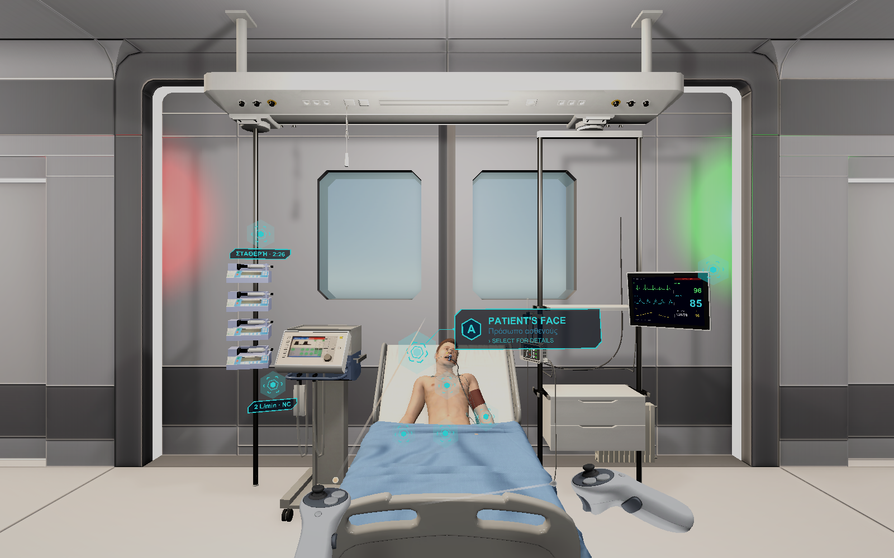
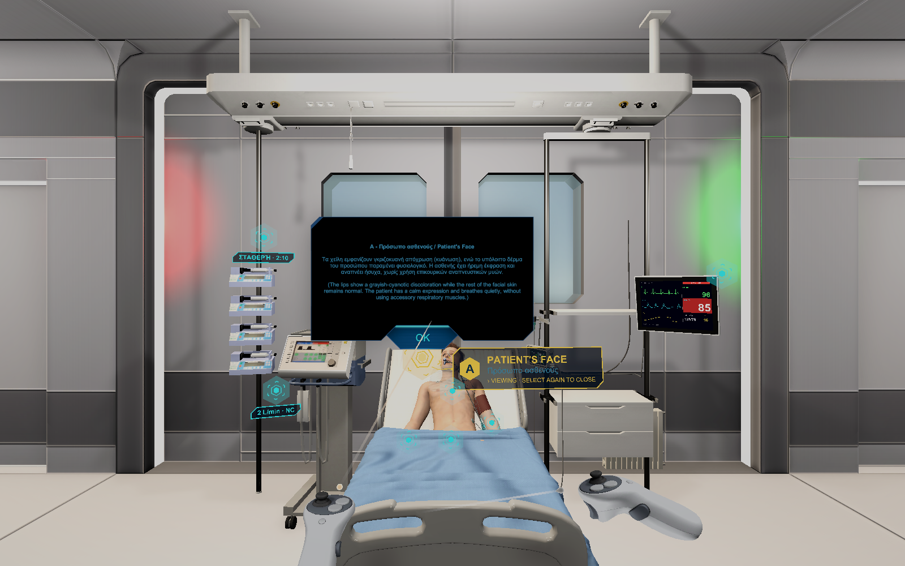
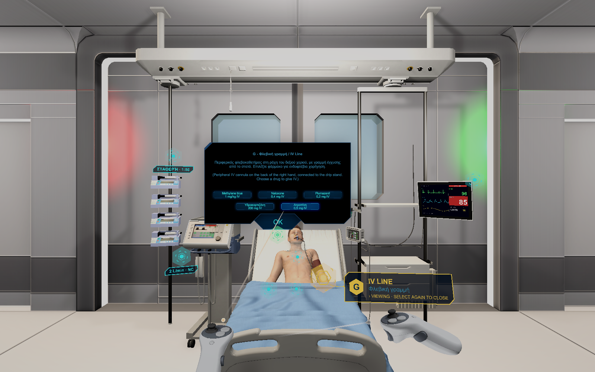

# VIROO CAVE point-of-interest and scenario framework

This is the code behind a training simulation I built for a 4-screen CAVE room running on
VIROO (Virtualware's XR platform). The scenario is methaemoglobinaemia: a patient whose oxygen
saturation sits stubbornly at 85% no matter what you do with the oxygen supply, and the only way
out is spotting the real cause and giving the right antidote.

Every wall of the CAVE runs its own VIROO Player, all joined to the same session, and whichever
one connects first becomes the leader. A trainee walks up to the patient and clicks small glowing
markers scattered around the room: the face, the hands, the chest, the monitor, the oxygen flow
meter, the IV line. Click one on any screen and the same popup opens on all four at once, the
marker hides itself so it can't be double-clicked, and when you close it, it reappears. That part
of the repo (`src/Networking/`) doesn't know anything about hospitals. It's a generic "shared
point of interest, synced across every connected client" system I'd reuse for a different scenario
without touching it.

The hospital scenario itself (`src/Scenario/`) is built entirely on top of that generic layer.

## What's actually interactive

Some points are pure observation, like the one above: click the patient's face and you get the
clinical finding in Greek and English (lips show cyanosis, rest of the skin is fine). Point C
(auscultation) is the negative finding that's supposed to throw you off: clear breath sounds,
which rules out a lung cause and makes the low saturation genuinely confusing.

Other points are actions with consequences:

The oxygen point lets a trainee swap between nasal cannula, simple mask, and non-rebreather, and
turn the flow up or down. None of it moves the saturation, which is the whole point of the case.
The IV line opens the menu above: five drugs pulled from the crash cart, each giveable once.
Four of them do nothing (picking wrong never hurts the patient), and the fifth, methylene blue, is
the actual antidote. Give it and the patient starts recovering. There's also an arterial blood
draw that takes a few seconds to process, then shows chocolate-brown blood and a blood gas report
with a raised methaemoglobin level on the co-oximetry panel, which is the moment most trainees go
"oh".

Behind all of it sits `ScenarioState`, one networked state machine every screen reads from. It
tracks the oxygen setting, the blood gas stage, which drugs have been given, and the patient's
clinical course (stable, worsening, severe, arrest, recovering, recovered), and it's the only
thing that writes any of those numbers. The monitor, the status chips, the popups: all of them are
just rendering whatever `ScenarioState` says, so four screens never disagree about what the
patient looks like. Left untreated, the patient deteriorates on a timer; give methylene blue in
time and they recover on a slower one, with the vitals gliding rather than snapping between
stages.

The bedside monitor in the screenshots is a real-time render, not a texture: it draws ECG, pleth,
and respiration traces sweep-style, like an actual monitor, and flashes an alarm banner when SpO2
drops below threshold. In arrest the traces go flat and it reads ASYSTOLE instead.

## Why there's no scene in here

The Unity project this came from also pulls in a hospital room asset pack, a sci-fi UI kit, and a
modular environment kit, all under commercial licenses that don't let me redistribute them. I'd
rather publish just the parts I actually wrote than ship a scene full of missing references, so
this repo is `src/` and `docs/` only. The screenshots above are from the real thing running.

## Layout

- `src/Networking/` - the generic point-of-interest system: `InteractionPoint`,
  `InteractionPointManager`, `PointOfInterestPopupUI`, plus `NetworkedVisibilityToggle` and
  `NetworkedAnimatorSync` for synced show/hide and synced looping animation.
- `src/Interactions/` - selection plumbing, including the fix for VIROO's desktop mode not
  routing mouse clicks through `EventSystem` to world-space UI.
- `src/Scenario/` - the methaemoglobinaemia case: `ScenarioState`, the interactive points
  (`OxygenActions`, `IvDrugActions`, `BloodGasActions`, `InstructorActions`), and the runtime
  displays (`PatientMonitorDisplay`, `ScenarioOutcomeBanner`).
- `docs/Interactions-And-Networking.md` - the architecture notes I wrote while building this:
  how VIROO's leader election and `NetworkVariable<T>` work, and the recipe I followed for every
  new networked interactable.

## Stack

Unity 6000.0 (URP), XR Interaction Toolkit + OpenXR, VIROO/Virtualware's networking SDK, DTrack
for the CAVE wands.
